# ProofPay (working title)

Escrow that pays when a verified fact says so. A payer locks mock USDC against a condition; the worker proves it with a [Primus zkTLS](https://docs.primuslabs.xyz) attestation; the escrow verifies the proof and releases the funds.

**Status: testnet beta.** Mock 6-decimals USDC on Base Sepolia, or Simulation with no chain at all. Contracts were **reviewed internally but not independently audited** ([SECURITY.md](SECURITY.md)). Do not use real funds. The product name lives in one constant (`src/lib/config.ts`).

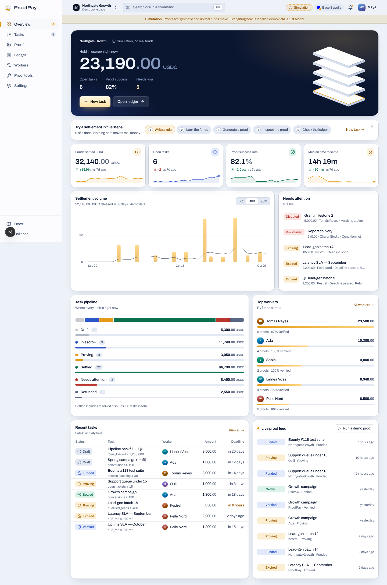

## Live vs Simulation (read this first)

| | Simulation (default, works with no keys) | Live (testnet) |
|---|---|---|
| Attestor | A **local test key** (public Hardhat account #1). Not Primus. | Primus attestors, trusted via `PRIMUS_ATTESTORS` and the on-chain verifier |
| TLS session | Not real: the demo source reports a value | Real, run by the worker's Primus extension |
| Signature, digest, binding, replay, window, rule checks | **Real** (same code path, real secp256k1) | Same |
| Chain transactions | Simulated hashes, no explorer links | Base Sepolia |
| Labelling | Persistent "Simulation" badge, banner, a tag on every simulated proof/export/demo | "Live (testnet)" badge |

**What has and has not been run.** Simulation and the contracts are fully tested (below). The Live path is implemented against the typings of `@primuslabs/zktls-js-sdk@0.3.15` but has **not** been exercised against Primus' service here (no credentials or template were available). The assumptions are listed in [DECISIONS.md D6](DECISIONS.md).

## Run it

```bash
pnpm install
pnpm dev          # http://localhost:3000  (site)   /app  (the product)
```

Demo data is seeded automatically (8 workers, ~36 tasks over ~72 days). `pnpm seed` reseeds; **Settings → Reset demo data** does the same from the UI. Locally it runs on PGlite (an in-process Postgres, in your temp dir unless `DATABASE_FILE` is set); set `DATABASE_URL` to use any Postgres such as Neon or Supabase.

| Script | What it does |
|---|---|
| `pnpm dev` / `build` / `start` | Next.js 16 |
| `pnpm lint` / `typecheck` | ESLint, `tsc --noEmit` |
| `pnpm test` | Vitest: domain, verification, service, Live mapping, API docs registry |
| `pnpm test:e2e` | Playwright flows + axe accessibility on 14 pages × 2 themes (`PW_CHROMIUM=/path/to/chrome` to reuse an installed browser) |
| `pnpm contracts:install` / `contracts:test` | Foundry deps / 34 contract tests ([install Foundry](https://book.getfoundry.sh)) |
| `pnpm seed` | Reset and reseed demo data |

## What's in the box

- **Web app** (`/app`): overview (hero with escrow balance, KPIs, task pipeline, top workers, activity), task builder (5 steps with a live sentence of the rule), task detail with role-aware actions, **Proof Inspector** (what the source saw / what the attestor signed / what the verifier learns, plus the six named checks), proofs, ledger with a reconciliation check and CSV/print, workers, **Proof tools** (verify any Primus attestation in the browser, SHA-256/Keccak hashing, rule-hash and additionParams calculator), settings (mode, Live readiness checklist, appearance, members, keys, webhooks, **Trust Model**).
- **Website** (`/`): home with an interactive settlement demo, product, three use-case pages, security & Trust Model, developers (quickstart, API reference, error codes), request-access (stored, rate-limited, honeypot), status (real checks), changelog, brand, legal **templates**.
- **Design system** (`/design`): the "Descent" direction: tokens, type, components, motion rules.
- **Escrow contract** (`contracts/`): `ProofPayEscrow` + tests with real signatures.
- **Demo partner API** (`partner-api/`): zero-dependency data source with token auth.
- **HTTP API** (`/api/*`): idempotency keys on writes, rate limits, typed errors with recovery steps.

| | |
|---|---|
| 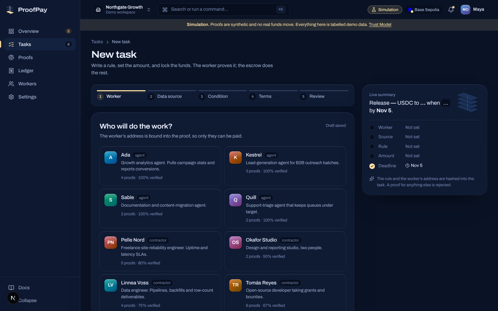 | 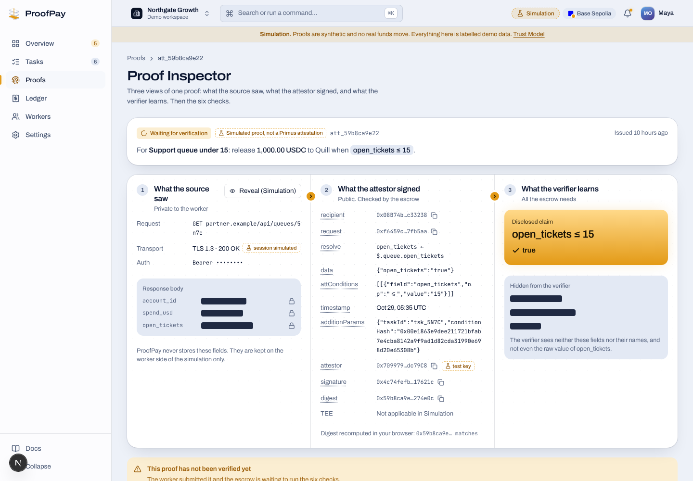 |
| 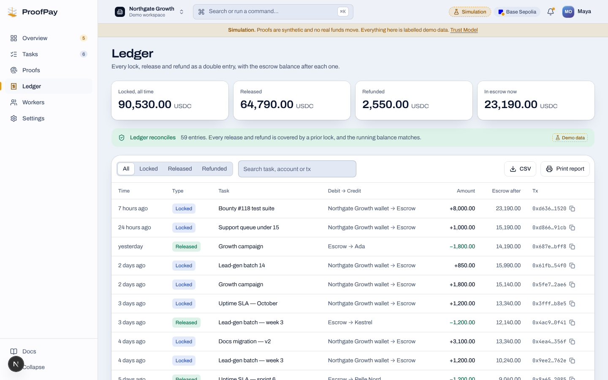 | 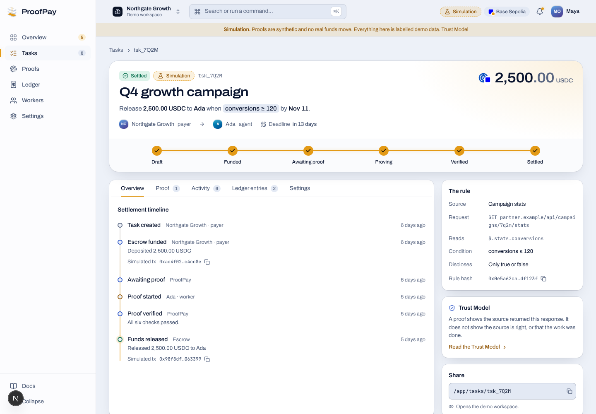 |
| 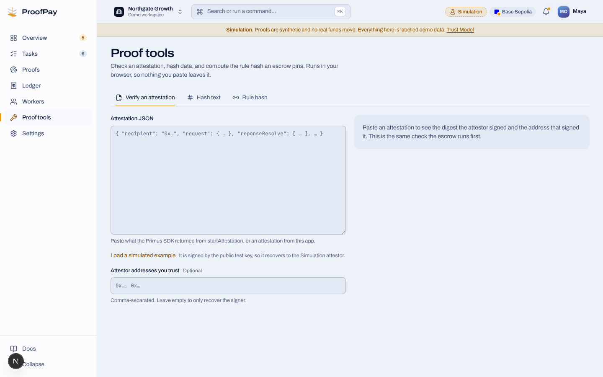 | 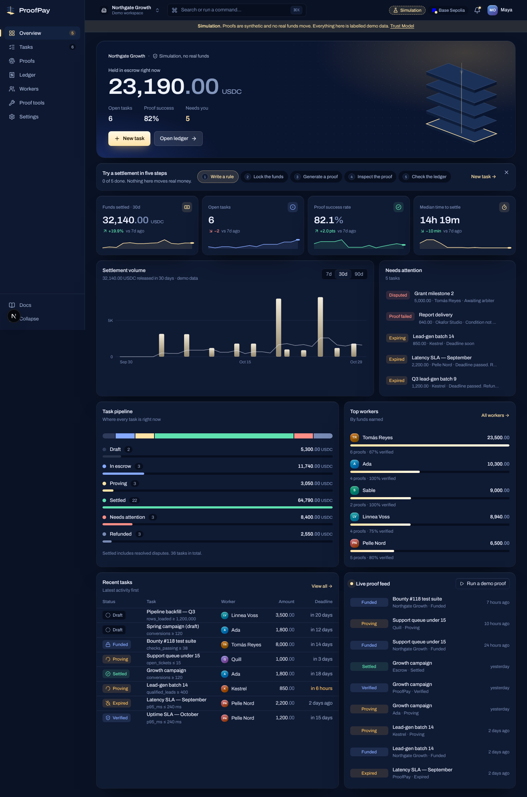 |

Responsive from 1440 to 390, light and dark:

| 1024 | 768 | 390 |
|---|---|---|
| 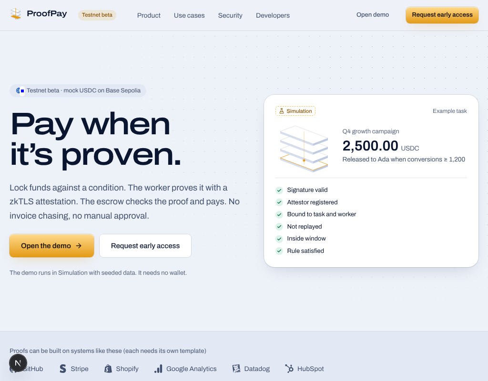 | 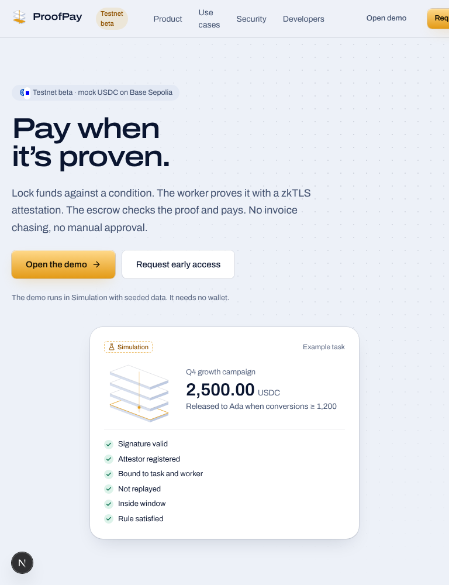 | 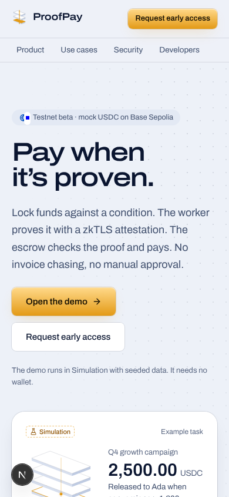 |

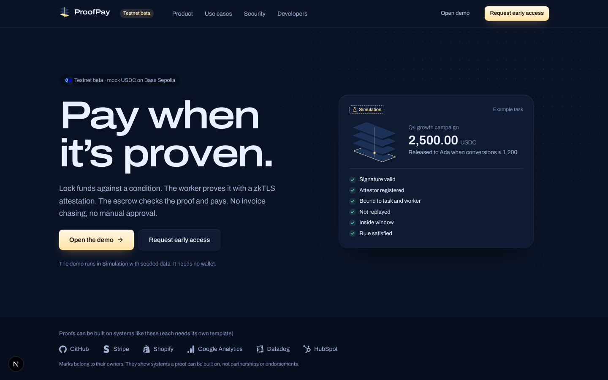

## Architecture

```
Worker's browser ── Primus extension ──► attestor ──► attestation (signed)
                                                         │
Payer ──► createTask / fund ──► ProofPayEscrow ◄── settle(id, attestation)
                                   │  checks: recipient, url, conditions, additionParams, data,
                                   │          replay (digest consumed once), window, deadline
                                   └──► IPrimusZKTLS.verifyAttestation (signature + registered attestor)
```

The backend runs the **same six checks** (`signature_valid`, `attestor_registered`, `bound_to_task`, `not_replayed`, `within_window`, `condition_satisfied`) so the UI, the API and the contract agree on what "verified" means. Primus' verifier only checks the signature (see [docs/primus-notes.md](docs/primus-notes.md) §2), so binding, replay and expiry are the escrow's job.

Task states: `draft → funded → awaiting_proof → proving → verified → settled`, with `expired → refunded` and `disputed → resolved`.

## Live mode (testnet)

1. Create a project in the [Primus Developer Hub](https://dev.primuslabs.xyz): you get `appId` and `appSecret`. Create a template for your partner-API request there.
2. Deploy `partner-api/` somewhere public (an attestor cannot reach localhost).
3. Set, server-side only (see `.env.example`): `PRIMUS_APP_ID`, `PRIMUS_APP_SECRET`, `PRIMUS_TEMPLATE_ID`, `PRIMUS_ATTESTORS`.
4. Contracts, on **your** machine with a throwaway testnet key (never commit or paste it): `PRIMUS_VERIFIER=0x… PRIVATE_KEY=… forge script script/Deploy.s.sol --rpc-url $BASE_SEPOLIA_RPC_URL --broadcast`. Re-check Primus' verifier address in their docs first.
5. Settings → Environment shows which variables are set; once the first four are, switch to **Live (testnet)**. On a Live task the worker presses *Start Primus attestation*: the browser calls `POST /api/tasks/{id}/proof/prepare` for a signed request, runs the Primus SDK (`init` → `startAttestation` → `verifyAttestation`), and posts the attestation to `/proof`. Paste any attestation into **Proof tools** to check its digest and signer.

Secrets never reach the client bundle: `appSecret` is used only in `src/lib/server/primus.ts` (`server-only`).

## Limitations

- Contracts are internally reviewed, **not independently audited**; testnet only. Live path not exercised against Primus (D6).
- The data source is trusted for its own numbers: a wrong dashboard yields a valid proof of a wrong number. Disputes rely on a named arbiter.
- Browser-extension attestation only (that is how the SDK works); no server-side proof generation.
- Demo auth: roles are a view switch, not accounts. API keys/members in Settings are demo data.
- Legal pages are templates, the security contact is a placeholder, the name is a working title.
- Local dev uses PGlite (single process); deployments use Postgres via `DATABASE_URL`. The schema is created on start, there are no versioned migrations yet.

## Brand and attribution

"Proofs by Primus zkTLS" is plain-text attribution. This project is independent and is not endorsed by or affiliated with Primus. Third-party marks (via `simple-icons` and `@web3icons/react`) belong to their owners and indicate systems a proof could be built on, not partnerships.
